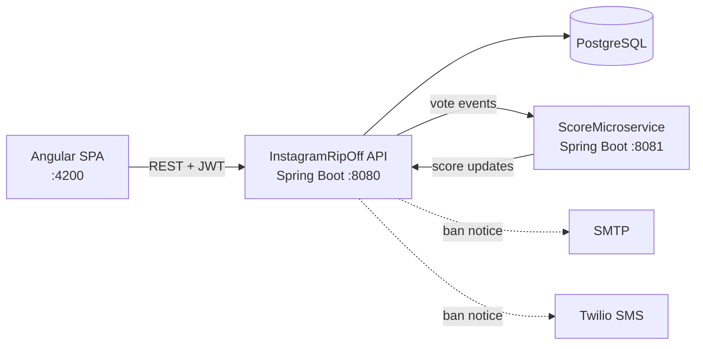

# InstagramRipOff

**A full-stack photo-sharing social network: Spring Boot REST API, a separate scoring microservice and an Angular SPA.**


Users publish posts with images and tags, comment on them and vote on posts and comments. Votes feed a
**reputation score** computed by a dedicated microservice. Administrators moderate content and users from a
dashboard; banned users are notified by **e-mail** and **SMS**.

## Features

- **Stateless JWT authentication** with Spring Security and BCrypt-hashed passwords; `USER` / `ADMIN` roles
- **Posts** with image URL, title, text and tags; search the feed by **title, tag or author**
- **Comments** with up/down votes; comments can be sorted by votes and turned off per post
- **Post lifecycle**: a post moves from `Just_Posted` to `First_Reactions` on its first comment and to `Outdated` when comments are closed
- **Reputation score** calculated by a separate Spring Boot service (post upvote +2.5, comment upvote +5, downvotes subtract points; downvoting someone else's comment also costs the voter)
- **Admin dashboard**: edit or delete any post or user, promote users to admin, ban / unban accounts
- **Ban notifications** by e-mail (Spring Mail) and SMS (Twilio), both optional
- Users cannot vote on their own content; banned users cannot log in

## Architecture



| Module | Responsibility |
|---|---|
| **`/` (InstagramRipOff API)** | Authentication, users, posts, comments, tags, votes, admin operations |
| **`ScoreMicroservice/`** | Applies the scoring rules for each vote and pushes the score change back to the API |
| **`FEinstagramRipOff/`** | Angular 19 single-page app (feed, post details, profile, admin dashboard) with Cypress E2E tests |

The backend follows a layered design: controllers → services → Spring Data JPA repositories → entities.

## Tech stack

| Layer | Technologies |
|---|---|
| Backend | Java 21, Spring Boot 3.4 (Web, Data JPA, Security, Mail), JJWT, Lombok, Twilio SDK |
| Database | PostgreSQL, Hibernate |
| Frontend | Angular 19, TypeScript, RxJS, SCSS |
| Testing | JUnit 5 / Spring Boot Test, Cypress |

## Getting started

Requirements: **JDK 21+**, **Node.js 18+** and a local **PostgreSQL** server.

```bash
git clone https://github.com/fdaniel18/instagram-copy.git
cd instagram-copy

# 1. Database (tables are created automatically by Hibernate)
psql -U postgres -c 'CREATE DATABASE "Instagram";'

# 2. Optional: override the defaults (DB credentials, JWT secret, mail, Twilio)
cp .env.example .env

# 3. Main API on :8080
./mvnw spring-boot:run

# 4. Scoring service on :8081 (in a second terminal)
cd ScoreMicroservice && ./mvnw spring-boot:run

# 5. Frontend on :4200 (in a third terminal)
cd FEinstagramRipOff && npm install && npm start
```

Open **http://localhost:4200** and create an account. New accounts get the `USER` role. To get an administrator,
promote an account and log in again:

```bash
psql -U postgres -d Instagram -c "UPDATE users SET role = 'ADMIN' WHERE username = 'your_username';"
```

### Configuration

All settings live in [`.env.example`](.env.example) and have development defaults, so the app starts without a
`.env` file. E-mail and SMS notifications are skipped unless their credentials are set.

| Variable | Default |
|---|---|
| `DB_URL`, `DB_USERNAME`, `DB_PASSWORD` | `jdbc:postgresql://localhost:5432/Instagram`, `postgres`, `postgres` |
| `JWT_SECRET` | development-only key |
| `MAIL_USERNAME`, `MAIL_PASSWORD` | empty (e-mail disabled) |
| `TWILIO_ACCOUNT_SID`, `TWILIO_AUTH_TOKEN`, `TWILIO_PHONE_NUMBER` | empty (SMS disabled) |
| `SCORING_SERVICE_URL` | `http://localhost:8081` |

## Tests

```bash
./mvnw test                         # backend integration tests (needs the PostgreSQL database)
cd FEinstagramRipOff && npx cypress open   # E2E flow: login, search, vote, comment, create post
```

The Cypress scenario logs in as `demo_user` / `demo_pass`, so register that account first.

## API overview

| Resource | Endpoints |
|---|---|
| Auth | `POST /Instagram/auth/register`, `POST /Instagram/auth/authenticate` |
| Posts | `GET/POST /posts`, `GET/PUT/DELETE /posts/{id}`, `GET /posts/{id}/detail`, `PUT /posts/{id}/comments`, `GET /posts/filterByTag`, `/filterByTitle`, `/filterByUser` |
| Comments | `GET/POST /comments`, `POST /comments/posts/{postId}`, `PUT/DELETE /comments/{id}` |
| Votes | `POST /votes/posts/{postId}/vote`, `POST /votes/comments/{commentId}/vote`, `GET /votes/posts/{postId}/sorted-comments` |
| Users | `GET /users`, `GET /users/{id}/posts`, `PUT /users/{id}`, `PUT /users/{id}/ban`, `PUT /users/{id}/role`, `DELETE /users/{id}` |
| Tags | `GET/POST /tags`, `GET /tags/{id}/posts`, `PUT/DELETE /tags/{id}` |

Every endpoint except `/Instagram/auth/**` requires an `Authorization: Bearer <token>` header.

## Team

Built as a university team project by [@fdaniel18](https://github.com/fdaniel18),
[@IliescuIonut](https://github.com/IliescuIonut) and a third teammate.
